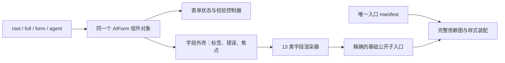

# AIForm 按需拆分可行性设计

状态：**Proposed，仅供评审；V1 实现保持停止**。设计基线为本地检查点 `631b7cd2ac696017c3b940e3c6325704f96aa898`，其主线基线为 V0 合并 SHA `b1eef9b6f5e1b64706beee5d4d56e08891f27c26`。

## 判断

**拆源文件、改成子入口导入、常规 CSS 压缩，都不足以解除当前停止点。** 精确导入可以修复模块图越界；全部 13 类字段、跨入口对象身份和 M1 预算同时保留时，CSS 达标仍未证明可行。

建议下一步最多批准一个隔离的 CSS 语义复用试验，先证明完整依赖闭包能够达标，再决定是否恢复 V1 实现。当前不建议直接实施整套组件重构，也不能把轻量新入口代替现有 AIForm 验收。

本设计来自负责人“先出 AIForm 拆分可行性设计供评审”的直接要求，见 [授权记录](../../../evidence/V1/aiform-design/authorization.json)。授权不包含恢复实现、改预算、开 PR、改版本或发布。

## 约束与来源

| 约束 | 必须保留的含义 | 来源 |
| --- | --- | --- |
| 字段能力 | input、textarea、number、select、checkbox、radio、switch、date、date-range、time、time-range、upload、tree-select 共 13 类，包含运行时 schema 切换 | [form-schema.ts](../../../packages/ai/src/form-schema.ts)；A2-3 零破坏 |
| 表单行为 | 受控父级拒绝/接受、默认值、条件显隐/禁用、分组、preserve、dependencies、同步/异步校验、取消过期请求、错误汇总与聚焦、提交/重置 | [form.vue](../../../packages/ai/src/form.vue)、[form.test.ts](../../../packages/ai/src/__tests__/form.test.ts) |
| 暴露接口 | `validate`、`resetFields`、`clearValidate`、`setFieldsErrors`；props/events/types 不变 | form.vue 的 defineExpose、defineProps、defineEmits |
| 对象身份 | root、full、scoped/agent 导出继续指向同一个组件/Plugin 对象；不通过入口包装对象区分弃用用法 | [负责人 V1 决定](../../../evidence/V1/owner-decisions-2026-11-17.json)；M1/M3 identity 断言 |
| 样式完整性 | 按当前停止点口径，统计该入口全部现有字段所需样式；外置共享文件和 Resolver sideEffects 也计入闭包 | [停止点证据及口径](../../../evidence/V1/aiform-budget/README.md)；A2-3；[M1 contract](../../../evidence/M1/contract.md) |
| 量化门槛 | 组件 CSS ≤ full 25%；theme ≤ 5%；theme + 闭包 ≤ 30%；JS gzip < full Plugin；相对对应 root named 增量 ≤ max(512 B, 1%) | M1 contract；A2-3，数值不变 |
| 依赖边界 | 包括被解析模块；不把所有基础组件登记成 AIForm 依赖以掩盖根 barrel | A2-3；M1 模块图口径 |
| 范围 | V1 仍覆盖基础 45 Ready 家族及既有 AI16/DND4 路径；本设计只分析一个阻塞，不是 V1 全量验收 | A2-3；[声明覆盖记录](../../../evidence/V1/entry-coverage.json) |

V3 的 namespaced Combobox/data 契约、V2 的根入口/产物布局切换均不引入本设计。

## 当前结构与测量

`AIForm → AIFormField → aheart-ui 根 barrel`。AIFormField 静态引用全部控件类型；根 barrel 又解析 Table、Typography 等无关模块。真实隔离 tarball 图中有 **106 个超出实际字段控件族的基础模块**，见 [模块图](../../../evidence/V1/aiform-budget/module-graph.json)。

13 类字段对应 13 个直接基础组件家族，另有 Icon、Tree、Tooltip 等传递依赖。AIForm 自身样式只有 4,788 B；当前 M3 消费页另导入 `aheart-ui/full.css`，并未证明独立按需样式完整。

| 测量 | full.css | 完整 AIForm 样式闭包 | 占比 | 组件上限 |
| --- | ---: | ---: | ---: | ---: |
| 当前原始样式片段去重 | 201,510 B | 100,048 B | 49.649% | 50,377.5 B（25%） |
| 相同 Vite 5.0.12 / minify:true 的隔离试验 | 177,470 B | 88,415 B | 49.820% | 44,367.5 B（25%） |

原始 theme + 闭包为 101,815 B，超过 60,453 B 的 30% 上限。一致压缩后的 theme + 闭包为 89,869 B，仍超过 53,241 B 的 30% 上限。

第二行是设计实验，执行退出码 0 仅表示测量成功，**两项 CSS 预算仍失败**。没有修改库样式或产物。命令、参数、输入/输出摘要与实验 CSS 在 [css-measurement.json](../../../evidence/V1/aiform-design/css-measurement.json) 和 [测量脚本](../../../evidence/V1/aiform-design/measure-css.mjs)。这不是视觉或兼容性验收。

100,048 B 是**当前样式资产的去重闭包**，不是未来所有架构的理论下界。它也不表示现有 AIForm 的 4,788 B 文件突然变大。后续可以研究语义复用或能证明完整的样式专用化，但不能遗漏依赖后只报自身文件大小。

### 减量难度

| 当前闭包中的较大片段 | 字节（不含片段分隔换行） |
| --- | ---: |
| DatePicker / DateRangePicker | 27,981 |
| TimePicker / TimeRangePicker | 11,480 |
| Select | 8,217 |
| Button | 7,347 |
| InputNumber | 6,356 |
| TreeSelect | 4,871 |
| Textarea | 4,782 |

仅优化 AIForm 自己的 4,788 B 不能解决问题：即使理论上压到 0，基础控件闭包仍有 95,260 B。

若完整 full.css 保持 201,510 B，需要让闭包减少至少约 49,671 B。若通过改共享基础样式减量，full.css 也会同步减小。设减少量为 `d`，AIForm 自身样式不变：

```text
100048 - d ≤ 0.25 × (201510 - d)
d ≥ 66227.333... B，整数至少 66228 B
```

这相当于当前相关基础样式约 **69.52%** 的减量。该式只适用于分子/分母同步减同样字节的模型；实际构建必须重新测量两个完整产物，不用公式代替验收。一般关系为 `闭包减量 ≥ 49670.5 + 0.25 × full 减量`。

## 候选结构



该拆分保留一个 canonical AIForm 导出。控制器和字段渲染器为内部实现，所有旧入口仅 re-export；没有新的 default/root 包装组件或 Plugin 对象。拆文件用于边界清晰和验证，不计作 CSS 减量。

| 层 | 责任 | 不应承担的职责 |
| --- | --- | --- |
| AIForm canonical SFC | 保留 props/events/expose、DOM 语义和生命周期入口 | 不按 import 路径生成不同对象 |
| 状态控制器 | 受控更新、默认值、隐藏/删除语义、校验代次、AbortSignal、提交/重置 | 不加载视图组件或样式 |
| 字段外壳 | 现有 label/description/error、range 双输入关联、首错聚焦 | 不改变业务 schema 或要求调用者新增注册步骤 |
| 字段渲染器 | 13 类字段映射，使用实际需要的公开子入口 | 不导入基础根 barrel 或 whole Plugin |
| 样式装配 | 从 manifest 的真实依赖集合收集所有必要规则，去重并保留 provenance | 不把规则藏进额外 CSS、运行时隐式导入或全局前置条件 |

源级精确导入是可独立验证的方向，例如 Button 来自 `aheart-ui/button`、Form/FormItem 来自 `aheart-ui/form`，其他控件按各自公开路径。类型导入与运行时导入分开。当前 AI peer 范围为 `workspace:^1.1.0`，部分公开路径到本次 1.4 候选才存在；实施前必须证明最低 peer 兼容，或由负责人决定相应依赖版本轨道，不能默默引入无法解析的安装组合。本次设计不改 peer、版本或发布。

### 方案比较

| 路线 | 模块图 | 完整字段能力 / 身份 | CSS 预算判断 |
| --- | --- | --- | --- |
| 只拆 SFC/TS 文件并改精确导入 | 可以去掉无关根解析，需真实 tarball 复验 | 可以保持 | 闭包不变；不足以解除停止点 |
| 精确导入 + 完整样式集合的语义复用/装配优化 | 可以保持声明边界 | 原则上可保留，需 cascade、主题、状态和实例隔离证明 | 唯一值得做最小试验的兼容候选；尚未证明能达 25% |
| 新增仅支持少数字段的轻量入口、要求业务手工提供全部渲染器、或改为运行时按字段偷偷加载 CSS | 表面可能变小 | 不满足现有完整用法或 style-free 契约 | 不能替代当前 AIForm 门禁，不纳入本 V1 方案 |

## 建议的下一步：只做隔离试验

建议仅评审是否批准 **S1**，不直接批准恢复整个 V1。

| 步骤 | 产物与出口 | 当前状态 |
| --- | --- | --- |
| S0 设计量化 | 真实 tarball 闭包、根解析图、一致压缩对照、减量公式 | 已完成本地测量；预算仍 Fail |
| S1 CSS 复用可行性试验 | 只在隔离目录生成候选 full/闭包 CSS、逐规则来源与差异；不改包源码、exports、对象或业务文件 | 待负责人评审授权 |
| S2 恢复实现 | 仅在 S1 有完整有效且达标的候选后，再按批准范围拆控制器/渲染器、改精确导入与样式装配 | 当前不启动 |
| S3 V1 全量验收 | 全部 Ready/已有路径、原预算、消费者/两试点、严格类型、SSR/hydration、五浏览器及 P0/P1=0 | 尚未开始全量验收 |

S1 优先检查相同上下文、相同声明的规则能否在保留选择器、顺序和 specificity 的条件下安全复用。更复杂的 CSS 专用化必须证明规则在现有 schema、ConfigProvider、主题、尺寸、禁用/加载/错误、popup/teleport 与异步状态下是否可达；没有证明就保留。不能用只跑默认 input 的截图推导其他 12 类字段。

每个入口的样式装配只包含其声明依赖，不能把全库选择器放入“共享 CSS”再让全部入口引用。完整闭包包含所有共享文件和 sideEffects；full 与闭包使用同一格式/压缩设置，保持 `style.css` 与 `full.css` 字节一致。

当前停止探针冻结 full.css 摘要是为复现 V0 资产、排除分母膨胀；这不是禁止以后优化 CSS 的新规范。若负责人批准等价优化试验，必须同时记录新旧 full 字节、完整闭包和所有比例，分母不得通过加入无关样式变大，比例阈值不变。不能只压缩分子而保留另一种格式的分母求过关。

S1 若不能给出预算内的完整候选，保留失败证据并继续停在 V1；不转而验收轻量替代入口、不跳过 AIForm，也不由代理缩小 A2 适用范围。当前没有达到“可安全恢复实施”的证据。

## 若后续获准实施的验收要求

| 验证面 | 必须证明的结果 |
| --- | --- |
| 身份与注册 | ESM/CJS root/full/scoped/agent 组件和 Plugin 的既有严格身份断言保留；双路径安装不重复注册 |
| 功能与类型 | 全部 13 类字段、既有 props/events/expose、受控拒绝/接受、默认值、显隐/disabled/preserve/dependencies、异步取消和错误恢复不变；strict `skipLibCheck:false` |
| CSS 与图 | 含全部解析模块，只有真实控件族与声明共享依赖；完整 CSS 闭包 ≤25%，theme≤5%，合计≤30%；JS-only 无 CSS，显式 CSS 不被摇掉；不隐藏额外资源 |
| JS | 同一隔离 tarball、Vite/Vue/压缩设置；每个入口 gzip 小于 full Plugin，root named 增量≤max(512 B,1%) |
| SSR/交互 | SSR/hydration 与字段 ID/label 一致；range 双输入、首错聚焦、键盘、teleport/iframe、reset/unmount 取消均复验 |
| 浏览器与视觉 | 沿用五个 Playwright 项目；覆盖所有字段和关键状态、宽/窄视口、主题与 ConfigProvider，不自动接受视觉差异 |
| 原消费端 | 两个已获准的过时测试调整之外，受保护业务/试点源码不改，实际 tarball 安装与原任务通过 |
| 全量范围 | AIForm 通过之后仍逐项执行其他入口门禁；其他组件失败仍按同一停止点报告，不据本设计宣称 V1 Pass |

现有 AIForm 单测只是回归起点，不能代替新增闭包与浏览器证据。G8 的真实操作任务、截图/录屏、URL、浏览器、视口和候选 SHA 待可用候选时冻结并由负责人验收，本设计不代签。

## 评审决定（留给负责人）

| 项目 | 决定 |
| --- | --- |
| 本可行性设计是否认可 |  |
| 是否仅批准 S1 隔离 CSS 复用试验 |  |
| 是否恢复 V1 实现 |  |

本设计和实验仅 Local；未创建 V1 PR、未合并/部署、未改版本、未发布 npm 或 tag。V0 的 Main CI/Pages 成功属于 [V0 回执](../../../evidence/V1/v0-postmerge/README.md)，不作为本设计的浏览器或 V1 验收结果。
